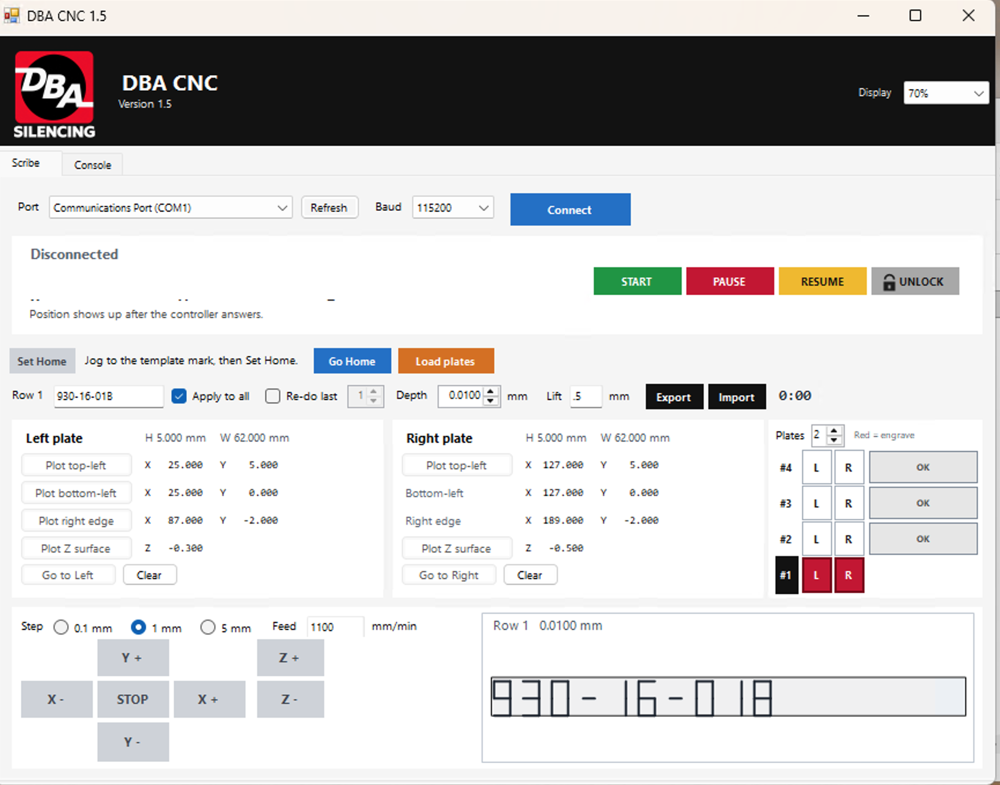
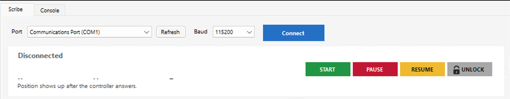
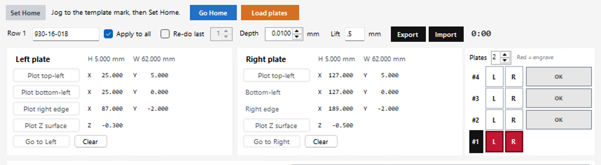
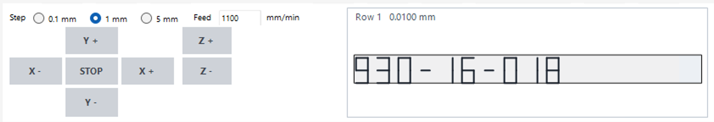
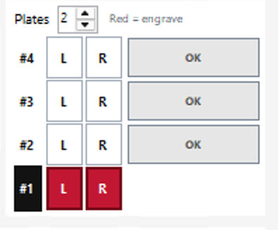

# ⚙️ DBA CNC

### Precision CNC Scribing Software for Windows

**A purpose-built desktop application for automated product identification and aluminum plate scribing.**

DBA CNC is a Windows-based CNC control application developed to simplify the process of engraving product identification numbers onto aluminum plates in a manufacturing environment.

Designed around a fixed plate fixture and a GRBL 1.1 motion controller, the application provides operators with a straightforward interface for connecting to the CNC machine, positioning the scribing tool, previewing toolpaths, and executing scribing operations.

The goal is simple: **make repetitive product identification tasks faster, more consistent, and easier to operate.**


---

## 🖥️ Application Overview



DBA CNC brings the essential CNC scribing controls into one application, allowing operators to manage the process without manually entering G-code commands.

The application operates relative to a work zero established by the operator at the beginning of each session, ensuring that scribing operations are aligned with the physical plate fixture.

---

## ✨ Features

### 🔌 GRBL Controller Connection

Connect directly to a GRBL 1.1 CNC controller using a USB serial connection.

- CH340 USB serial communication.
- 115200 baud connection.
- Integrated controller connection interface.
- Direct communication with the CNC motion controller.

### 📐 Scribe Path Plotting

Preview the scribing path before performing an operation.

- Plot product identification toolpaths.
- Visualize planned scribing movements.
- Review positioning before executing a job.

### 🎮 Manual Jogging Controls

Position the scribing tool using integrated jogging controls.

- Manually control CNC movement.
- Establish the work zero for each session.
- Align the tool with the fixed plate fixture.
- Prepare the machine for accurate scribing.

### 🏷️ Plate Template Selection

Work with different plate configurations using the application's template selection interface.

- Select plate templates.
- Support optional plate configuration files.
- Work with product identification data from CSV files.

---

## 📸 Application Walkthrough

A closer look at the core controls and functionality.

<table>
  <tr>
    <td width="50%" align="center">
      <b>01. Controller Connection</b>
      <br><br>
      
      <br><br>
      Connect to the CNC controller through USB serial communication.
    </td>
    <td width="50%" align="center">
      <b>02. Scribe Path Plotting</b>
      <br><br>
      
      <br><br>
      Preview the planned scribing path before running a job.
    </td>
  </tr>
  <tr>
    <td width="50%" align="center">
      <b>03. Manual Jogging</b>
      <br><br>
      
      <br><br>
      Position the machine and establish the work zero.
    </td>
    <td width="50%" align="center">
      <b>04. Plate Templates</b>
      <br><br>
      
      <br><br>
      Select plate configurations for product identification.
    </td>
  </tr>
</table>

---

## ⚙️ How It Works

DBA CNC follows an operator-controlled workflow designed for repetitive plate scribing.

**Step 1: Connect**

Connect the CNC controller to the Windows workstation using the CH340 USB serial interface.

**Step 2: Position**

Use the manual jogging controls to position the scribing tool and establish the work zero.

**Step 3: Configure**

Select the appropriate plate template and prepare the product identification information.

**Step 4: Preview**

Plot and review the planned scribing path.

**Step 5: Scribe**

After the operator has prepared the machine and manually engaged the spindle button, execute the scribing operation.

**Important:** DBA CNC does not automatically start the spindle. The scribing process uses a drag operation, and spindle engagement remains the responsibility of the machine operator.

---

## 🛠️ Technical Specifications

| Component | Specification |
|---|---|
| Application | DBA CNC |
| Version | 1.5 |
| Platform | Windows |
| Programming Language | C# |
| Framework | .NET Framework 4 |
| CNC Controller | GRBL 1.1 |
| Connection | USB Serial (CH340) |
| Baud Rate | 115200 |
| Machine Configuration | Fixed aluminum plate fixture |
| Coordinate Reference | Operator-defined work zero |
| Deployment | Standalone Windows executable |
| Backend Server | Not required |

The application runs locally as a single Windows program without requiring a separate server or web frontend.

---

## 📁 Project Structure

```text
dba-cnc/
│
├── .github/
│   ├── GitHub Actions workflows
│   └── Bug report template
│
├── assets/
│   ├── Application screenshots
│   ├── Header logo
│   ├── Application icon artwork
│   └── Sample product CSV
│
├── docs/
│   └── user-guide.md
│
├── src/
│   ├── Application source code
│   └── Build.bat
│
├── .gitignore
├── LICENSE
└── README.md
```

---

## 🚀 Installation & Setup

### Prerequisites

Before running DBA CNC, ensure your workstation has:

- A Windows operating system.
- .NET Framework 4.
- A GRBL 1.1-compatible CNC controller.
- A CH340 USB serial connection configured for 115200 baud.
- A compatible CNC machine and fixed plate fixture.

### Building From Source

**1. Clone the repository**

```bash
git clone https://github.com/YOUR-USERNAME/dba-cnc.git
```

**2. Navigate to the source directory**

```cmd
cd dba-cnc\src
```

**3. Build the application**

Run:

```cmd
Build.bat
```

**4. Locate the executable**

The build generates:

```text
src\DBA CNC.exe
```

**5. Deploy**

Copy `DBA CNC.exe` to the Windows workstation connected to the CNC machine.

Optional configuration files, including `plate-template.txt` and product CSV lists, can be placed alongside the executable as required.

For daily operation instructions, see the [Operator User Guide](docs/user-guide.md).

---

## 🏭 Designed for Manufacturing

DBA CNC was developed around the practical requirements of a production environment.

Rather than relying on general-purpose CNC software for repetitive identification tasks, the application provides a focused interface tailored to a specific machine, fixture, and workflow.

Its design emphasizes:

- **Simplicity:** Essential machine controls in one interface.
- **Consistency:** Repeatable toolpath generation for product identification.
- **Efficiency:** Streamlined preparation and execution of recurring scribing jobs.
- **Operator Control:** Manual positioning, work-zero setup, and spindle engagement.
- **Local Operation:** No network connection or external service required.

---

## 📖 Documentation

Detailed operating instructions are available in the [DBA CNC Operator Guide](docs/user-guide.md).

The guide provides additional information for operators working with the CNC machine.

---

## 📄 License

**Copyright © 2026 DBA. All rights reserved.**

This project is proprietary software. Refer to the [LICENSE](LICENSE) file for applicable terms and restrictions.

---

### Built for real-world manufacturing applications.

*DBA CNC, Version 1.5*
